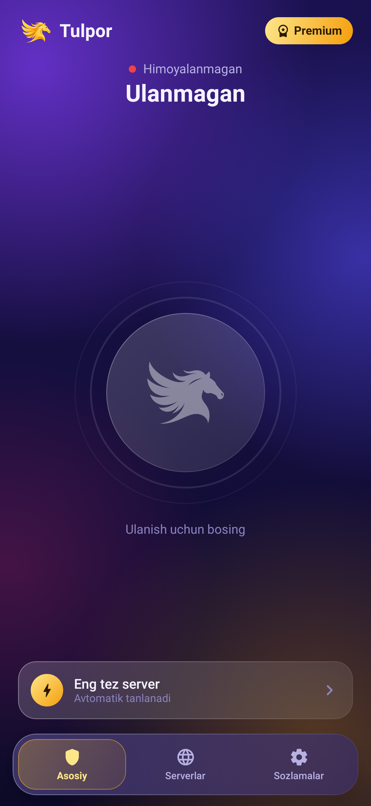
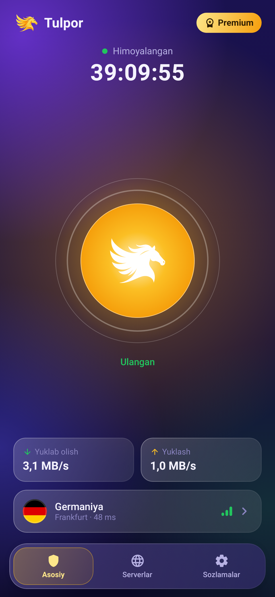
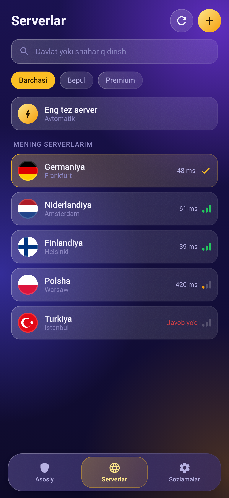
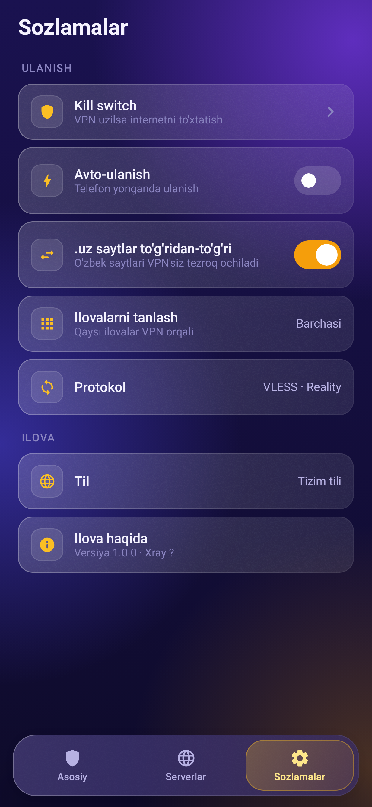
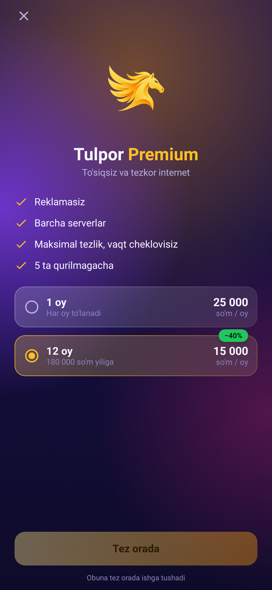

# Tulpor VPN

Bloklangan saytlarni ochish uchun Android VPN ilovasi.
Protokol: **VLESS + Reality + Vision** (Xray-core). Bunday trafik oddiy HTTPS'dan farqlanmaydi.

| Asosiy | Ulangan | Serverlar | Sozlamalar | Premium |
|---|---|---|---|---|
|  |  |  |  |  |

## Imkoniyatlar
- Bitta tugma bilan ulanish, ulanish vaqti, yuklab olish/yuklash tezligi
- Eng tez serverni avtomatik tanlash (har bir server orqali haqiqiy so'rov bilan ping)
- `vless://` havolalarni qo'shish: qo'lda, buferdan, boshqa ilovadan "Ulashish" orqali yoki obuna (subscription) havolasi bilan
- `.uz` saytlarini VPN'siz ochish (tezroq), lokal tarmoq har doim to'g'ridan-to'g'ri
- Ilovalarni tanlash (split tunneling): hammasi / faqat tanlanganlar / tanlanganlardan tashqari
- Avto-ulanish (telefon yonganda), Quick Settings plitkasi, bildirishnoma orqali uzish
- Kill switch: Android'ning "Doimiy VPN" sozlamasi orqali
- 3 til: o'zbek, rus, ingliz
- Glassmorphism dizayn (Android 12+ da haqiqiy blur, eskilarida yarim shaffof)

## Server o'rnatish (1 buyruq)
Ubuntu 22.04/24.04 VPS'da (Hetzner, DigitalOcean, Vultr va h.k.):

```bash
curl -fsSL https://raw.githubusercontent.com/ismatillayeveldurbek-lab/VPN/main/server/install.sh | sudo bash
```

Skript Xray'ni o'rnatadi, Reality kalitlarini yaratadi, BBR'ni yoqadi va `vless://` havola hamda QR kodni chiqaradi.
Havolani ilovada **Serverlar → +** orqali qo'shasiz.

- Havolani qayta ko'rish: `sudo bash install.sh link`
- Yana bir qurilma uchun foydalanuvchi qo'shish: `sudo bash install.sh add-user`
- Sozlash: `PORT=443 SNI=www.microsoft.com NAME="DE-Frankfurt"` (buyruq oldidan yoziladi)

Server nomini `DE-Frankfurt` ko'rinishida bersangiz, ilova davlat bayrog'i va nomini o'zi aniqlaydi.

## Loyiha tuzilishi
```
app/        Android ilova (Kotlin, Jetpack Compose, Haze blur)
core/       VPN yadrosi (Go, Xray-core) → gomobile orqali tulporcore.aar
server/     VPS o'rnatish skripti
branding/   Logo, ikonkalar, ranglar
design/     Dizayn maketlari
scripts/    Build skriptlari
```

## Build
Kerak: JDK 17+, Android SDK (platform 36, NDK 27), Go 1.24+.

```bash
./scripts/build-core.sh
```

```bash
./gradlew :app:assembleRelease
```

Release imzosi uchun loyiha ildizida `keystore.properties` bo'lishi kerak (gitga qo'shilmaydi):

```properties
storeFile=signing/tulpor-release.jks
storePassword=...
keyAlias=tulpor
keyPassword=...
```

> Imzo kalitini (`.jks`) va parolni xavfsiz joyda saqlang: ilovaning keyingi versiyalari faqat shu kalit bilan imzolansa, eski versiya ustidan o'rnatiladi.

## Testlar
```bash
./gradlew :app:testDebugUnitTest
```

```bash
cd core && go test ./...
```

To'liq VPN yo'li sinovi (Linux, root kerak). "Telefon" tarmoq muhiti → TUN → ilova yaratgan Xray sozlamasi → VLESS + Reality → `install.sh` yaratgan server → sayt, DNS ham tunnel orqali:

```bash
XRAY=/path/to/xray ./core/e2e/tun_e2e.sh
```

`core` testlari ichida haqiqiy VLESS + Reality + Vision server va mijozni ishga tushirib, tunnel orqali so'rov yuboradigan end-to-end test bor. Ilova yaratgan Xray konfiguratsiyasi ham Xray'ga yuklab tekshiriladi.

Ekran rasmlarini yangilash:

```bash
./gradlew :app:testDebugUnitTest --tests '*ScreenshotTest*' -Droborazzi.test.record=true
```
